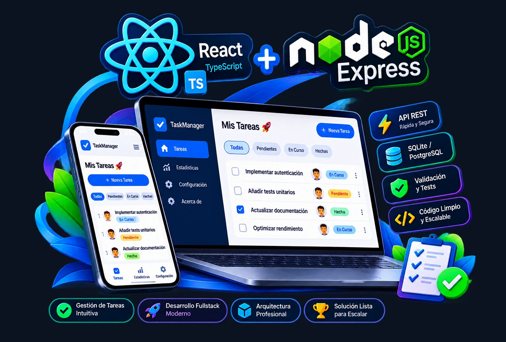
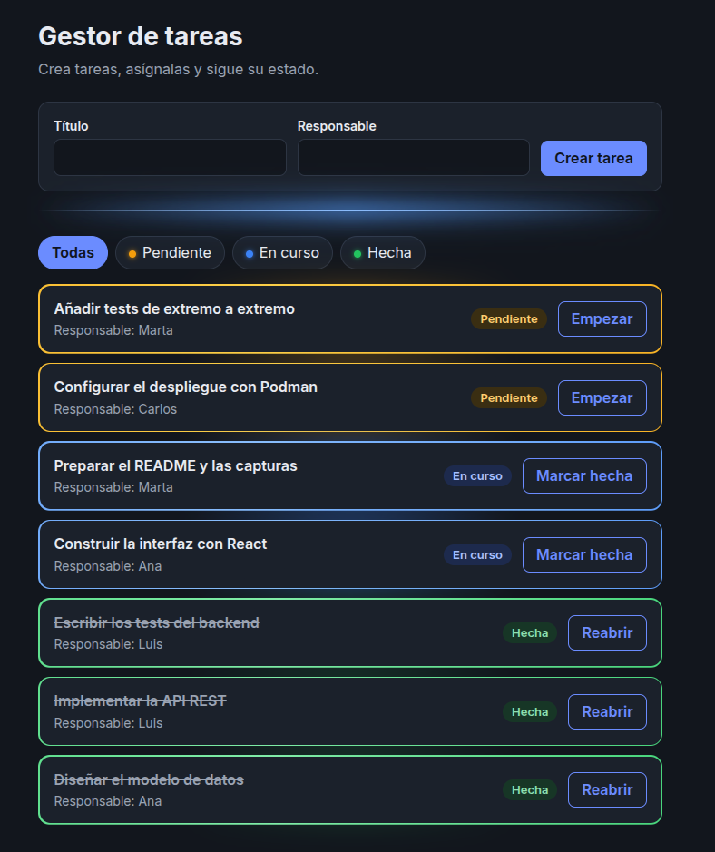
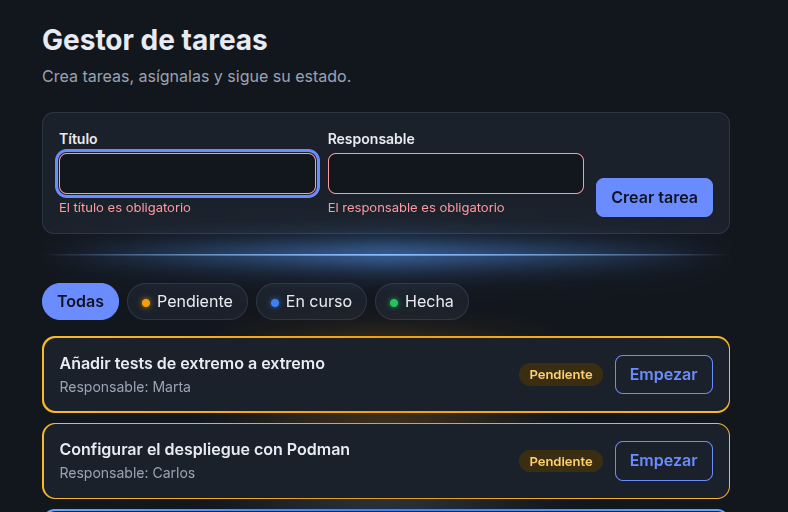
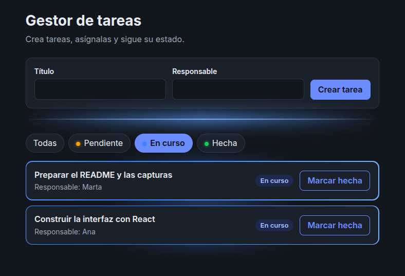
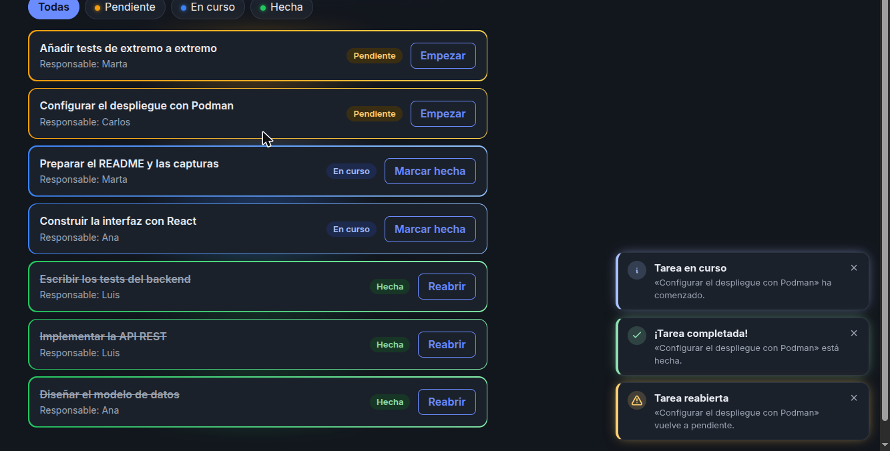
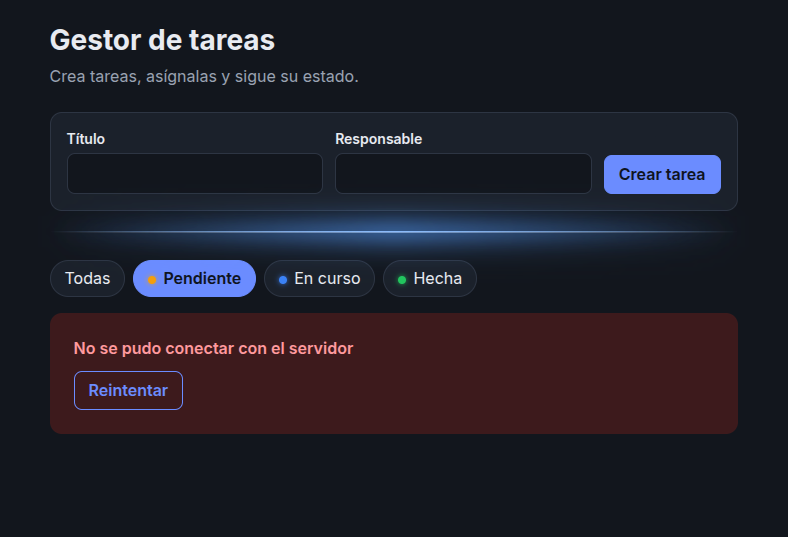

# Gestor de tareas · React + Node + TypeScript

Aplicación pequeña de gestión de tareas con API REST y interfaz web, hecha como prueba técnica. Todo en TypeScript: **Express + SQLite** en el servidor y **React + Vite** en el cliente.

<p align="center">
  
  <br>
  <sub><i>Ilustración conceptual del proyecto. No es una captura de la aplicación: las capturas reales están justo debajo.</i></sub>
</p>

<p align="center">
  
</p>

## Qué hace

- Crear tareas (título y responsable), listarlas y **cambiar su estado**: `Pendiente → En curso → Hecha` (y reabrir).
- **Filtrar por estado.** Cada estado tiene su color (ámbar, azul y verde) en la tarjeta, en la insignia y en el filtro.
- **Notificaciones** en cada momento de la vida de una tarea: creada, en curso, completada y reabierta.
- Validación de los datos en el cliente **y** en la API, con los códigos HTTP correctos (`201`, `400`, `404`…).
- **Estados de carga y de error visibles**, con botón «Reintentar».
- **Datos de ejemplo** cargados automáticamente la primera vez, para que no arranque en blanco.
- 71 tests (15 de backend y 56 de frontend), tema claro/oscuro automático y accesibilidad cuidada (etiquetas, foco, `aria-*`, `prefers-reduced-motion`).

| Validación del formulario | Filtro por estado |
|:--:|:--:|
|  |  |
| **Notificaciones del ciclo de vida** | **Error de conexión** |
|  |  |

## Cómo ejecutarlo

Necesitas **Node 22+** (para el modo local) o **Podman / Docker** (para contenedores).

### Opción A — Contenedores, un solo comando

```bash
podman compose up --build      # o:  docker compose up --build
```

Abre **http://localhost:8090**. La base de datos queda en un volumen y sobrevive a los reinicios. Para parar: `podman compose down` (añade `-v` si quieres borrar también los datos). Detalles, decisiones y problemas resueltos en [`docs/despliegue-con-contenedores.md`](docs/despliegue-con-contenedores.md).

### Opción B — En local, para desarrollar

```bash
npm install
npm run dev                    # o:  ./scripts/dev.sh
```

- Web: http://localhost:5173 · API: http://localhost:3001/api/health
- El servidor de la web reenvía `/api` a la API, así que el navegador habla con un solo origen (sin CORS).
- Por separado: `./scripts/api.sh` y `./scripts/web.sh`.
- La base de datos es un archivo en `server/data/tasks.db` (se crea sola; está ignorada por git).

### Datos de ejemplo

La primera vez que arranca, si la base está **vacía**, la API carga 7 tareas de ejemplo (con los tres estados) para que la aplicación no se vea en blanco. Es seguro: **nunca toca una base que ya tenga datos** y reiniciar no las duplica. Para arrancar sin ellas: `SEED_DEMO=false` (en local, `SEED_DEMO=false npm run dev`; con contenedores, añade `SEED_DEMO: "false"` en `environment` del servicio `api`). Código en `server/src/seed.ts`.

### Tests y calidad

```bash
npm test                       # 71 tests: backend (Vitest + Supertest) y frontend (Vitest + Testing Library)
npm run build -w server        # compila el backend
npm run build -w web           # compila el frontend
```

## API

Todas las rutas cuelgan de `/api`. Los estados son `pending`, `in_progress` y `done`.

| Método y ruta | Cuerpo | Respuesta |
|---|---|---|
| `GET /api/tasks` | — | `200` lista, de la más nueva a la más antigua |
| `GET /api/tasks?status=done` | — | `200` lista filtrada · `400` si el estado no existe |
| `POST /api/tasks` | `{ "title", "assignee" }` | `201` la tarea creada · `400` datos inválidos |
| `PATCH /api/tasks/:id/status` | `{ "status" }` | `200` la tarea · `400` datos inválidos · `404` no existe |
| `GET /api/health` | — | `200` `{ "status": "ok" }` |

Todos los errores tienen la misma forma, para que el frontend los trate en un solo sitio:

```json
{ "error": "Datos inválidos", "details": [ { "field": "title", "message": "El título es obligatorio" } ] }
```

```bash
curl -X POST http://localhost:3001/api/tasks -H 'Content-Type: application/json' \
     -d '{"title":"Preparar la demo","assignee":"Luis"}'
```

## Estructura

```
server/src/   app.ts · routes/tasks.ts · taskRepository.ts · db.ts · seed.ts · schemas.ts · errors.ts · tests/
web/src/      App.tsx · components/ (TaskForm, TaskList, TaskItem, NeonCard, GlowLine…) · toast/ · hooks/useTasks.ts · api/tasksApi.ts
docs/         un documento por módulo, decisiones y registro del uso de IA
compose.yaml  api + web (nginx) con un volumen para la base de datos
```

## Decisiones que tomé

Resumen; el detalle y las alternativas descartadas están en [`docs/decisiones.md`](docs/decisiones.md).

- **Express** (no NestJS): el enunciado lo permite y, con un límite de 3 h, evita la ceremonia de módulos y decoradores sin renunciar a una estructura limpia.
- **SQLite** (`better-sqlite3`): cero configuración y un solo archivo; los tests usan una base **en memoria**, rápida y aislada.
- **Capas separadas** en la API: rutas (HTTP) → repositorio (todo el SQL, siempre con parámetros) → base. `createApp(db)` está separado del arranque para probar la app entera sin abrir puertos.
- **Zod** como única fuente de verdad: valida y, a la vez, da los tipos de TypeScript. La base además tiene un `CHECK` propio sobre los estados (doble defensa).
- **Un manejador central de errores** con formato único; el 404 también sale en JSON.
- **Capa de datos del frontend aislada** (`tasksApi` + `useTasks`): los componentes no conocen `fetch`. El hook descarta las respuestas antiguas si el usuario cambia de filtro rápido (condición de carrera).
- **Se valida en el cliente y en la API** (mismos límites): respuesta inmediata, pero la API manda.
- **Estados en inglés en el contrato, en español en pantalla.**
- **CSS plano, sin Tailwind ni framer-motion.** Los efectos visuales (`GlowLine`, `NeonCard`) y las notificaciones partían de componentes escritos para Next.js + Tailwind; los porté a React + CSS para no añadir dependencias, y quité lo que pesaba o era frágil (partículas aleatorias, estado en cada movimiento del ratón).
- **Contenedores que sobreviven a un reinicio:** nginx vuelve a resolver el nombre de la API (Podman le cambia la IP al reiniciarla) y la API cierra de forma ordenada con `SIGTERM`.
- Tests que buscan **por rol, etiqueta y texto** (lo que ve el usuario), y verificados con **pruebas de mutación**: rompí el código a propósito para comprobar que los tests fallan cuando deben.

## Qué haría con más tiempo

- Tests de extremo a extremo (Playwright) contra la app real.
- Compartir los límites de validación entre cliente y servidor en un paquete común, en vez de duplicarlos.
- Actualización optimista al cambiar de estado (hoy se recarga la lista).
- Paginación y búsqueda; poder editar y borrar tareas; autenticación y responsables como usuarios reales.
- Migraciones de base de datos y logs estructurados; integración continua que ejecute los tests y el build.
- Probar y ajustar el tema claro con capturas (se razonó, pero las capturas son del tema oscuro).

## Cómo usé la IA

Usé **Claude Code** (asistente de IA en la terminal) durante toda la prueba, trabajando por pasos cortos: yo decidía el alcance y el orden, la IA proponía y escribía un trozo pequeño, explicaba cada decisión, y no pasábamos al siguiente sin comprobarlo (el backend, antes que el frontend; cada módulo con su documento).

- **Qué le pedí:** montar el proyecto, escribir el backend, el frontend y los tests, probarlos en el navegador, documentar cada módulo y preparar los contenedores.
- **Qué acepté:** la estructura en capas, el uso de Zod, el repositorio, el manejador central de errores, la capa de datos del frontend y la mayor parte del código de los componentes y de los tests.
- **Qué aporté yo:** el alcance, el orden de trabajo, las ideas de diseño (capturas, el separador con resplandor, las tarjetas de color, las notificaciones y los datos de ejemplo) y los componentes de partida, que estaban escritos para otro stack y la IA adaptó.
- **Qué se corrigió o se descartó**, entre otras cosas:
  - Se instalaron primero las dependencias en un disco NTFS que **perdía archivos en silencio**; se detectó con una comprobación y se movió el proyecto a un disco ext4.
  - Se llegó a confirmar `node_modules` en git: se corrigió con un `.gitignore` y reescribiendo el commit antes de subir nada.
  - Un error interno de npm con Vitest 4 llevó a borrar `node_modules` un rato; se resolvió con `legacy-peer-deps` y se comprobó con `npm ci` en una copia limpia.
  - Al probar los contenedores de verdad aparecieron tres fallos: un puerto ocupado, un 502 tras reiniciar la API (nginx guardaba la IP antigua) y un reinicio de 10 s porque Node ignoraba `SIGTERM`. Se diagnosticaron con los logs y se corrigieron.
  - El linter marcó un `setState` dentro de un efecto en el hook; se reescribió derivando `loading`.
  - Los tests pasaban a la primera, así que se **rompió el código a propósito** para comprobar que fallaban (pruebas de mutación).
- El registro completo, con los tropiezos, está en [`docs/uso-de-ia.md`](docs/uso-de-ia.md).

## Documentación por módulo

Índice en [`docs/README.md`](docs/README.md): base de datos y validación, rutas y errores, datos de ejemplo, tests del backend, cliente y hook, lista y filtro, formulario, tests de componentes, efectos visuales, notificaciones y contenedores.
